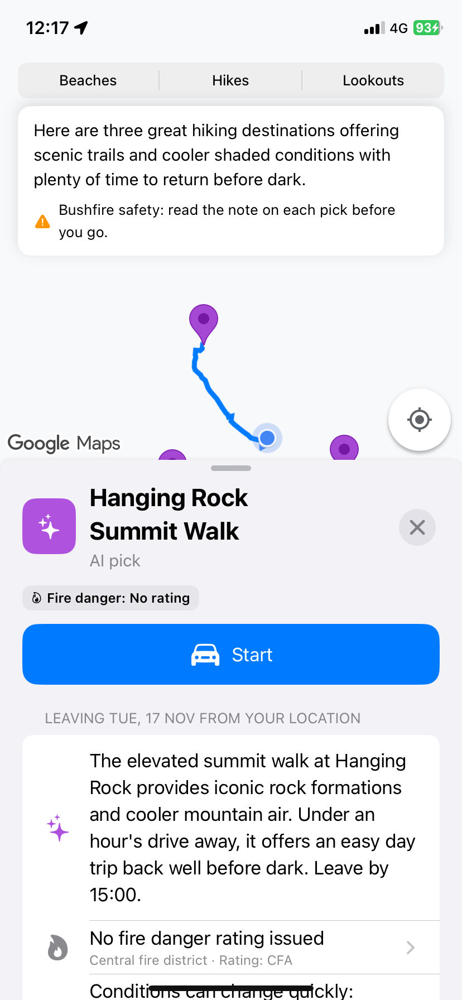

# Getaway

**Plan a safe Victorian day trip in one question.** Getaway picks the hikes, beaches or lookouts, tells you when to leave to beat traffic, and checks the bushfire danger before you go.

---

## Why this app

Every summer weekend in Melbourne, planning a day trip means the same twenty minutes of research: search for a hike or a beach, check the reviews, check the traffic, and, if you remember, check the fire danger. Three apps for three questions:

1. **Where should I go?** Getaway finds real places that fit your request and explains why each one fits.
2. **When should I leave?** It compares traffic for four departure times on your chosen day and shows the minutes you save.
3. **Is it safe to go there that day?** It checks the official CFA Fire Danger Rating and Total Fire Ban for each place, and on dangerous days it simply won't send you into the bush.

One question, a few seconds, up to three safe and explained picks. **Safety and the user's limits are enforced in code, not left to the AI.**

## Features

- **Real places from Google:** beaches, bushwalks and lookouts from the Places API, with ratings and addresses.
- **When to leave:** traffic-aware drive times for four departure times on the chosen date, fetched in parallel; the fastest is highlighted with the minutes it saves, and its route is drawn on the map.
- **AI trip planner:** plain-English requests answered with up to three real places, each with a reason and a leave-by time.
- **Bushfire safety:** the CFA's official Fire Danger Rating and Total Fire Ban for each pick's fire district on the trip date, with hard safety rules enforced in code.
- **Directions:** Start hands off to the Google Maps app with the exact place ID. An in-app turn-by-turn version using the Google Navigation SDK is built (`NavigationViewController`) and is enabled when the Cloud project has billing.
- **Native and accessible:** UIKit bottom sheets, diffable lists, SF Symbols, Dynamic Type, dark mode and VoiceOver announcements.

## Architecture

~~~
iOS app (Swift, UIKit)
 ├── Google Maps SDK              ─ map, pins, route line
 ├── Places SDK                   ─ category search (beaches, hikes, lookouts)
 ├── Routes API                   ─ 4 departure times in parallel (task group)
 ├── Google Maps app handoff      ─ directions (Navigation SDK version built, needs billing)
 └── AgentService ──HTTPS + app token──►  FastAPI backend (Render)
                                            │
             1. Places search (2 queries, in parallel)        ┐
             2. Drive times: Route Matrix, or parallel         │ plain code:
                Compute Routes if the matrix is refused        │ fast, free,
             3. Sunset time (astral, pure maths)               │ predictable
             4. CFA fire danger + Total Fire Ban per district  │
             5. Rules: remove unsafe places and places outside │
                the user's drive limit                        ┘
             6. ONE Gemini call: choose up to 3 and explain   ← the only AI step
             7. Guardrail: only real place IDs; facts come from our data
~~~

## Engineering decisions

For a full walkthrough of every part (request flow, concurrency, the agent pipeline, bushfire rules, testing, the traffic experiment and the problems I hit), see **[docs/ENGINEERING.md](docs/ENGINEERING.md)**.

### The AI agent: a fixed pipeline, not an open loop
- **One Gemini call per plan.** Searching, routing, sunset and fire checks are plain code; Gemini only does what needs judgement (choosing and explaining). Cost and latency are predictable, and the free quota covers far more plans.
- **Structured output.** Gemini answers in an exact Pydantic schema, so there is no fragile JSON parsing.
- **The model never owns facts.** It returns place IDs, reasons and leave-by times only. Names, coordinates, drive times and fire ratings come from Google's and the CFA's data, and any place ID the model invents is dropped.
- **Rules live in code, not in the prompt.** Places that are unsafe, or outside the user's drive limit, are removed before the model sees them. The evaluation proved why: the model once ignored a drive limit the prompt told it to respect.
- **Graceful degradation, never silent.** A chain of fallback Gemini models (on quota, overload, server errors and timeouts), then a rule-based planner. Every fallback is logged, and the response says whether AI answered.
- **Low thinking, capped output, 60-second timeout.** Choosing from a short verified list needs little reasoning, so the agent asks for the minimum, and a slow model is skipped instead of blocking the user.

### Bushfire safety, enforced in code
- **Official data:** the CFA's district feeds (Fire Danger Rating and Total Fire Ban), matched to each place through its local council and the CFA's list of councils per fire district.
- **Hard rules before the model runs:** Catastrophic days are never suggested; bush trips (hikes, forests, waterfalls) on Extreme days or days of Total Fire Ban are removed. Removed places can't be chosen, even by a mistaken model.
- **Unknown is never "safe":** beyond the forecast window, or if a feed fails, the app says so and asks people to check before they go.
- **In the app:** a fire danger badge in the rating's colours (always with the level written out), the official action message ("Be ready to act"), the fire district, a link to VicEmergency, credit to the CFA, and a VoiceOver announcement of the safety note. The full note lives in each pick's scrollable sheet, so a large banner never covers the map.

### iOS
- **Concurrency:** departure-time requests run in a `withThrowingTaskGroup`; a new search cancels the old `Task`, so a slow, stale response can't overwrite newer results; `CLLocationManager` is bridged to `async` with a continuation.
- **Safe decoding:** new API fields are optional, and unknown fire ratings decode as "unknown" instead of failing the whole plan.
- **Map camera:** fits the route and every pick above the sheet, so no suggestion is hidden.
- **Cost:** field masks request only what the UI shows; route estimates are cached per destination, day and rounded origin.

### Security
- Keys live in gitignored files (`Secrets.xcconfig`, `backend/.env`) and in Render's encrypted settings; a pre-commit hook blocks Google API keys.
- The iOS key is restricted to this app's bundle ID; the backend requires an app token, checked in constant time.

## Results

### Agent evaluation
An evaluation suite (`backend/evals/`) runs 15 realistic requests through the real planner and checks every answer with plain code: drive limits respected, back before dark, relevant picks, real places only, latency, and whether AI or the fallback answered.

**Full run, 15 cases:**

| Metric | Result |
|---|---|
| Answered by AI | 15 / 15 |
| Picks relevant to the request | 31 / 31 |
| Back before dark (hike requests) | 3 / 3 |
| Picks within the user's drive limit | 25 / 28, now enforced in code (below) |
| Median / slowest response | 4.1 s / 10.9 s |
| Cases with picks | 13 / 15; one correctly empty (no ski resort within 30 minutes of Melbourne) |

**Problems the evaluation found, each fixed with a regression test:**

| Problem found | Fix |
|---|---|
| Route Matrix refused (403), silently leaving every place without a drive time | Logged failures, plus automatic fallback to parallel Compute Routes |
| The error handler crashed on Google's list-shaped error responses | Defensive error parsing |
| A single Gemini call took about 270 seconds | Low thinking level, a token cap, a 60-second timeout and lighter fallback models: the same case finished in 7.9 seconds |
| The model chose 3 places with no known drive time despite a 70-minute limit | The drive limit is enforced in code before the model runs |
| A Gemini 504 timeout failed the whole plan | Server errors and timeouts now fall back to the next model, then the rule-based planner |

### Holiday traffic forecasting (research experiment)
A spatio-temporal graph neural network (graph layer + GRU) forecasting the next 24 hours of traffic at 58 signalised intersections on the Nepean Highway, from Victoria's open SCATS data (Sep 2025 to Jan 2026). Trained only on data before 20 December 2025 and tested on the holidays; also evaluated walk-forward with weekly retraining.

| Model | WAPE, test period | WAPE, public holidays | Peak-hour error on holidays |
|---|---|---|---|
| LightGBM | 10.9% | 25.9% | 0.3 h |
| GNN (graph + GRU) | 14.0% | 27.8% | 2.0 h |
| Same model without graph (ablation) | 14.3% | 28.9% | 2.0 h |
| Same hour last week | 17.0% | 61.1% | 3.3 h |
| Historical average | 17.2% | 74.0% | 4.3 h |

**Findings:** LightGBM was the most accurate model. The GNN cut holiday error by more than half against simple baselines, and the road graph gave a small, consistent gain over the identical model without it (single runs; multi-seed runs are the next step). Weekly retraining barely helped on holidays: two recent holiday days are too few to learn from. Code and details in `traffic-gnn/`.

## Testing
- **Backend:** 30 pytest tests, run on every push by GitHub Actions: drive-limit parsing and enforcement, the place-ID guardrail, the rule-based planner, Route Matrix parsing and its fallback, falling back on Gemini server errors, CFA feed parsing, council-to-district matching, and every bushfire rule.
- **Agent:** the evaluation suite above, run by hand against the real APIs.
- **Google APIs:** `scripts/check_google_apis.sh` checks every API accepts our keys and prints Google's reason when one doesn't.

## Limitations
- Fire danger forecasts cover about four days ahead, and the CFA only issues ratings on days with fire risk; other days show "not forecast yet" or "no rating". Getaway is a planning aid, not an emergency warning service: always check VicEmergency before leaving.
- Places are matched to fire districts by local council; councils split between districts use the more dangerous rating.
- Without billing, Google applies small daily quotas (for example on drive-time requests); when they run out, Getaway won't suggest places it can't verify against the user's drive limit.
- Map tiles and in-app navigation require a billing-enabled Google Cloud project; without one, pins, routes and the planner still work, and directions open in the Google Maps app.
- The traffic model uses detector counts (volume, not speed) on one corridor, with one holiday season of data.

## Getting started

**Requirements:** Xcode 26+, iOS 17+, [XcodeGen](https://github.com/yonaskolb/XcodeGen), Python 3.13, a Google Cloud project, and a Gemini API key.

1. In Google Cloud, enable **Maps SDK for iOS**, **Places API (New)** and **Routes API** (plus **Navigation SDK** for in-app navigation). Create an iOS key restricted to bundle ID `com.hieutong.getaway`, and a server key for the backend.
2. iOS app:

~~~bash
cp Secrets.example.xcconfig Secrets.xcconfig   # add your iOS key, team and backend URL
brew install xcodegen && xcodegen generate && open Getaway.xcodeproj
~~~

3. Backend:

~~~bash
cd backend && python3 -m venv .venv && source .venv/bin/activate
pip install -r requirements.txt -r requirements-dev.txt
cp .env.example .env                           # add your keys
python -m pytest -q                            # unit tests
python -m uvicorn app.main:app --reload        # local server
python -m evals.run_eval                       # agent evaluation (uses the real APIs)
~~~

## Project structure

~~~
Getaway/                iOS app (UIKit)
  ViewController.swift                    map, pins, AI plan, summary card
  DestinationDetailViewController.swift   place sheet: reason, fire safety, leave times
  FireSafety.swift                        fire danger levels and badge
  GoogleMapsHandoff.swift                 directions in the Google Maps app
  NavigationViewController.swift          in-app turn-by-turn (Navigation SDK)
  AgentService / RoutesService / PlacesService / LocationProvider
backend/                FastAPI agent
  app/agent.py          planning pipeline, safety and drive-limit rules
  app/fire.py           CFA feeds and fire districts
  app/tools.py          Places, Routes, sunset
  tests/                unit tests
  evals/                agent evaluation suite
traffic-gnn/            holiday traffic forecasting experiment
scripts/                Google API checks
docs/                   engineering guide and screenshots
~~~

## Data and credits
Place data and maps from Google Maps Platform. Fire Danger Ratings and Total Fire Bans from the [CFA](https://www.cfa.vic.gov.au), used under the feed's terms for personal, non-commercial use. Traffic data: Victoria Department of Transport and Planning, CC BY 4.0.

## Roadmap
- In-app navigation and map tiles on a billing-enabled project.
- CarPlay: directions and fire safety on the car's screen.
- Holiday traffic forecasts in the app, from a calendar-only model precomputed for known holidays.
- An evaluation report that separates infrastructure failures (such as exhausted API quotas) from model failures.

## Author
**Hugh (Hieu) Le**, iOS engineer, Master of AI (RMIT) · [GitHub](https://github.com/HieuTong)
